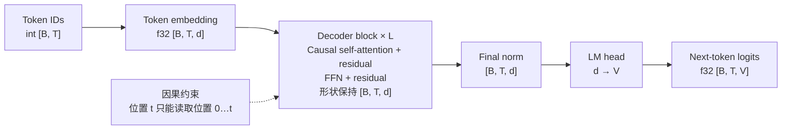

# Decoder-only causal Transformer：从 token IDs 到 next-token logits

其中，`B` 是 batch size，`T` 是序列长度，`d` 是模型宽度，`L` 是 decoder block 的层数，`V` 是词表大小。

每个位置都会输出一组长度为 `V` 的分数：`logits[b, t, :]` 用于预测该位置**后面的 token**。因果约束保证位置 `t` 的预测只使用位置 `0…t` 的输入。输出是 logits，不是概率；需要概率时再对词表维度应用 softmax。
